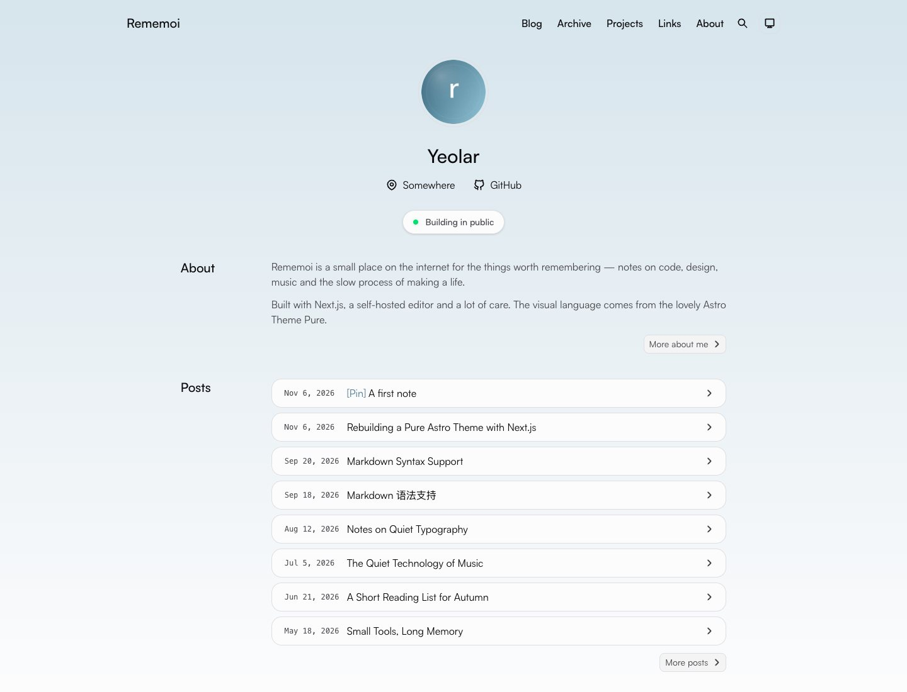
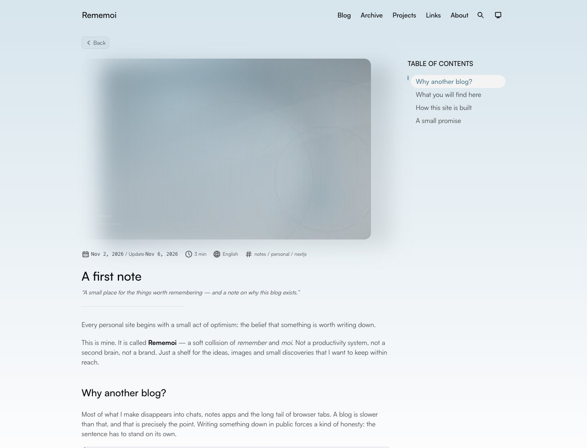

# Rememoi

A quiet personal blog built with **Next.js 16**, inspired by the design of [Astro Theme Pure](https://github.com/cworld1/astro-theme-pure). The original theme is a beautiful Astro project; this repository is a Next.js port that keeps the visual language and adds a database-backed admin editor and a small JSON API.



## What is inside

- **Faithful design port** — the same design tokens, typography scale, sticky scroll-aware header, animated post previews, table of contents, code blocks, tags and archive views.
- **Markdown & MDX** — GFM, footnotes, tables, task lists, KaTeX math, Shiki syntax highlighting with dual themes, line highlight/diff notation, titles, copy buttons and automatic code collapse.
- **Content pipeline** — posts live in a libSQL/SQLite database. `content/blog/**` is used to seed the database on first run.
- **Writing admin** — GitHub OAuth (or a local development login), post CRUD, drafts, publishing, cover and inline image uploads, a Markdown editor and a real site preview.
- **Search** — a generated JSON index searched client-side with Fuse.js.
- **SEO plumbing** — canonical URLs, Open Graph/Twitter metadata, RSS, sitemap, robots.txt and a web manifest.
- **Optional comments** — Waline, disabled until you provide a server URL.

| Layer | Choice |
| --- | --- |
| Framework | Next.js 16 App Router, React 19 server components |
| Styling | Tailwind CSS v4, design tokens ported from Astro Theme Pure |
| Content | Markdown/MDX + libSQL (SQLite locally, Turso in production) |
| Rendering | `next-mdx-remote/rsc`, remark/rehype, Shiki, KaTeX |
| Editing | Protected `/admin` area with a Markdown editor |
| Auth | Auth.js v5 (GitHub OAuth, allowlist) + local dev credentials |
| Search | Fuse.js + `/search-index.json` |
| Comments | Waline (optional) |



## Quick start

```bash
pnpm install
cp .env.example .env.local
pnpm dev
```

Open <http://localhost:3000>. `pnpm dev` creates the database from `content/blog` automatically. In development a local admin login is available at `/admin/login`:

- username: `admin`
- password: `rememoi` (change it with `ADMIN_DEV_PASSWORD`)

The local login is **disabled in production** unless you explicitly set `ENABLE_DEV_LOGIN=true`. Configure GitHub OAuth for production (see below).

### Requirements

- Node.js 20+
- pnpm 9+ (the project uses pnpm; npm/yarn should also work)

## Environment variables

| Variable | Required | Description |
| --- | --- | --- |
| `NEXT_PUBLIC_SITE_URL` | production | Canonical site URL, e.g. `https://rememoi.example.com`. Defaults to `http://localhost:3000`. |
| `DATABASE_URL` | no | libSQL URL. Defaults to `file:./data/rememoi.db`. Use `libsql://...` for Turso. |
| `DATABASE_AUTH_TOKEN` | for remote | Token for the remote libSQL database. |
| `AUTH_SECRET` | production | Secret used to sign sessions. Generate with `openssl rand -base64 32`. |
| `REMEMOI_API_TOKEN` | for API writes | Bearer token for create/update/upload and agent access. Generate with `openssl rand -base64 32`. |
| `AUTH_GITHUB_ID` | production | GitHub OAuth app client ID. |
| `AUTH_GITHUB_SECRET` | production | GitHub OAuth app client secret. |
| `ADMIN_GITHUB_LOGINS` | production | Comma-separated GitHub usernames allowed into `/admin`. |
| `ADMIN_DEV_PASSWORD` | no | Password for the local development login. Defaults to `rememoi`. |
| `ENABLE_DEV_LOGIN` | no | Set to `true` to enable the local login in production. |
| `NEXT_PUBLIC_WALINE_SERVER` | no | Waline server URL. Comments stay hidden when empty. |

> `NEXT_PUBLIC_*` variables are inlined at build time. Set them before `pnpm build`. Server-only variables such as `AUTH_SECRET` are read at runtime.

### GitHub OAuth

1. Create an OAuth app in GitHub → Settings → Developer settings.
2. Set the authorization callback URL to `https://your-domain.com/api/auth/callback/github` (for local development use `http://localhost:3000/api/auth/callback/github`).
3. Put the client ID/secret in `.env.local`, set `AUTH_SECRET`, and set `ADMIN_GITHUB_LOGINS` to your GitHub username.
4. Restart the app and open `/admin`.

If the auth variables are missing, `/admin` shows a setup card instead of the editor. The public site is unaffected.

## Writing

### In the admin editor

Go to `/admin`, create a post, write in Markdown or MDX, upload a cover image, save it as a draft, open the preview, and publish when it is ready.

- **Drafts** are excluded from the public site in production. During development they are visible on the public site with a `(Draft)` badge, matching the original theme's behavior.
- **Preview** (`/preview/[id]`) is protected and renders the real article layout, including interactions.
- **Uploads** are stored in the database and served through `/api/media/[id]` with immutable caching. This keeps media portable across hosts; for very large media consider swapping in object storage.
- **Publishing** invalidates the public pages, RSS, search index and sitemap with `revalidatePath`.

### Seeding from Markdown

`content/blog/**` is the initial content source. Run:

```bash
pnpm db:setup   # creates tables; seeds only when the database is empty
pnpm db:seed    # DESTRUCTIVE: clears posts and re-imports content/blog
```

Once you edit a post in the admin area, the database is the source of truth. The Markdown files are kept as portable fixtures and are not automatically overwritten.

A seed post looks like this:

```md
---
title: 'Hello, Rememoi'
description: 'A small place for the things worth remembering.'
publishDate: 2026-11-02
updatedDate: 2026-11-06
tags: [notes, personal]
language: 'English'
pin: true
comment: true
heroImage: { src: './cover.jpg', color: '#659EB9', width: 1600, height: 1000 }
---

Your content starts here.
```

Relative image paths (`./cover.jpg`, `./figure.jpg`) resolve to `/blog-media/<slug>/<file>` in `public/`. You can also use absolute URLs or paths.

### MDX components

Available inside `.mdx` posts without imports:

`<Aside>`, `<Collapse>`, `<Tabs>`, `<TabItem>`, `<Steps>`, `<Spoiler>`, `<Timeline>`, `<Button>`, `<Card>`, `<Label>`, `<Icon>` and `<Quote>`.

````mdx
<Aside type='tip'>
A short note that deserves its own block.
</Aside>

<Steps>

1. Write the first draft.
2. Read it out loud.
3. Publish.

</Steps>

<Tabs syncKey='stack'>

<TabItem label='Next.js'>

Rendered with server components.

</TabItem>

<TabItem label='Database'>

Stored in libSQL.

</TabItem>

</Tabs>
````

Code fences support an optional title and Shiki notation comments:

````md
```ts title="src/lib/posts.ts"
const posts = await getVisiblePosts() // [!code highlight]
```
````

## API

### Public

| Method | Endpoint | Description |
| --- | --- | --- |
| `GET` | `/api/posts?tag=&page=1&limit=10` | Published posts, paginated. `limit` is capped at 50. |
| `GET` | `/api/posts/<slug>` | A published post, including rendered headings and reading time. |
| `GET` | `/search-index.json` | Search index used by `/search`. |
| `GET` | `/rss.xml` | RSS 2.0 feed with full post HTML. |
| `GET` | `/sitemap.xml` | Sitemap for static pages, posts and tags. |
| `GET` | `/robots.txt` | Robots rules (admin and admin APIs are disallowed). |
| `GET` | `/api/media/<id>` | Image uploaded through the admin editor. |

### Write API (authenticated)

| Method | Endpoint | Description |
| --- | --- | --- |
| `POST` | `/api/posts` | Create a post. JSON body validated with Zod. |
| `PATCH` | `/api/posts/<slug>` | Partially update a post. Omitted fields are preserved. |
| `GET` | `/api/admin/posts` | All posts, including drafts (summaries). |
| `GET` | `/api/admin/posts/<id>` | One post with body. |
| `PATCH` | `/api/admin/posts/<id>` | Update a post by id. |
| `DELETE` | `/api/admin/posts/<id>` | Delete a post. |
| `POST` | `/api/admin/upload` | `multipart/form-data` with a `file` field. JPEG/PNG/WebP/GIF/AVIF, max 8 MB. |

Write requests accept either the Auth.js admin session cookie (the browser editor) or a server-side bearer token:

```http
Authorization: Bearer <REMEMOI_API_TOKEN>
```

Set `REMEMOI_API_TOKEN` in the server environment. Unauthenticated write requests return `401`, and `503` is returned when neither a session provider nor an API token is configured. Invalid payloads return `422` with a list of issues.

Create/patch payload:

```json
{
  "title": "A new post",
  "slug": "a-new-post",
  "description": "One or two sentences.",
  "body": "## Hello\n\nMarkdown or MDX goes here.",
  "format": "mdx",
  "status": "draft",
  "pinned": false,
  "commentsEnabled": true,
  "language": "English",
  "tags": ["notes", "nextjs"],
  "heroImage": { "src": "/api/media/<id>", "width": 1600, "height": 1000, "color": "#659EB9" },
  "publishDate": "2026-11-07T12:00:00.000Z",
  "updatedDate": null
}
```

`PATCH` accepts any subset of these fields. Slugs are validated against `^[a-z0-9]+(?:-[a-z0-9]+)*$` and made unique automatically.

```bash
export REMEMOI_API_TOKEN=<long-random-value>

curl -X POST http://localhost:3000/api/posts \
  -H "Authorization: Bearer $REMEMOI_API_TOKEN" \
  -H "Content-Type: application/json" \
  -d @post.json

curl -X PATCH http://localhost:3000/api/posts/a-new-post \
  -H "Authorization: Bearer $REMEMOI_API_TOKEN" \
  -H "Content-Type: application/json" \
  -d '{"status":"published"}'
```

Creating or updating a post revalidates the public pages, RSS, search index and sitemap automatically.

## Agent skill (DSH)

The repository ships a DSH-compatible skill at `.dsh/skills/rememoi-api`. It wraps the read/write endpoints in a small CLI so an agent can list, read, create, update and upload assets without constructing requests by hand.

Install it for the current user:

```bash
mkdir -p ~/.dsh/skills
ln -s "$PWD/.dsh/skills/rememoi-api" ~/.dsh/skills/rememoi-api
```

DSH also discovers skills under a project's `.dsh/skills` directory; placing or symlinking the skill there works as well. The skill is loaded as `rememoi-api` in the session catalog.

```bash
export REMEMOI_BASE_URL=http://localhost:3000
export REMEMOI_API_TOKEN=<server token>

node ~/.dsh/skills/rememoi-api/scripts/rememoi.mjs list --limit 5
node ~/.dsh/skills/rememoi-api/scripts/rememoi.mjs get hello-rememoi
node ~/.dsh/skills/rememoi-api/scripts/rememoi.mjs create --file post.json
node ~/.dsh/skills/rememoi-api/scripts/rememoi.mjs update hello-rememoi --file patch.json
```

The full instructions, payload examples and troubleshooting live in [`.dsh/skills/rememoi-api/SKILL.md`](.dsh/skills/rememoi-api/SKILL.md).

## Project structure

```
content/blog/           Markdown/MDX seed posts + their media references
.dsh/skills/rememoi-api/ DSH agent skill (SKILL.md + API CLI)
docs/                   README preview images
public/                 Static assets, seed media, tool icons, favicons
scripts/
  db-setup.ts           Create tables and import seed posts
  generate-assets.py    Regenerate the covers, avatar, social card and favicons
src/
  app/
    (site)/             Public pages (home, blog, tags, archives, about, links, projects, search, terms, preview)
    admin/              Admin login, dashboard and editor
    api/                Public and admin API route handlers
    rss.xml/  …         Feed and index routes
  auth.ts               Auth.js configuration
  components/           UI, site chrome, content and MDX components
  config/               Site + links configuration
  lib/                  Database, posts service, markdown pipeline, validation, utilities
  types/                Shared types
```

## Scripts

| Command | Description |
| --- | --- |
| `pnpm dev` | Set up the database, then start the dev server. |
| `pnpm build` | Set up the database, then build for production. |
| `pnpm start` | Start the production server. |
| `pnpm db:setup` | Create tables and seed only when the database is empty. |
| `pnpm db:seed` | Clear posts and re-import `content/blog`. |
| `pnpm typecheck` | TypeScript checks. |
| `pnpm lint` | ESLint (Next.js + React rules). |
| `pnpm format` | Format with Prettier. |

## Deployment

### Vercel + Turso (recommended)

1. Create a Turso database and get its URL and token.
2. Set `DATABASE_URL`, `DATABASE_AUTH_TOKEN`, `NEXT_PUBLIC_SITE_URL`, `AUTH_SECRET`, `AUTH_GITHUB_ID`, `AUTH_GITHUB_SECRET` and `ADMIN_GITHUB_LOGINS` in Vercel.
3. Deploy. The build runs `pnpm db:setup`, which creates the tables and seeds the initial content if the database is empty.
4. Add the production callback URL to the GitHub OAuth app.

The SQLite driver also works on a VPS with a persistent volume; do not use a local `file:` database on a serverless platform where the filesystem is ephemeral.

### Self-hosting

```bash
pnpm install
pnpm build
pnpm start
```

Set the environment variables from the table above. Uploaded images live in the database, so they survive redeploys as long as the database does.

## Customisation

- **Site metadata / navigation / footer / integrations** — `src/config/site.ts`.
- **Friend links and link logbook** — `src/config/links.ts`.
- **Colours and typography** — `src/app/globals.css` (the `:root` and `.dark` token blocks are a direct port of the Astro theme).
- **Public pages** — `src/app/(site)`.
- **Admin UI** — `src/components/admin` and `src/app/admin`.
- **Fonts** — the site loads [Satoshi](https://www.fontshare.com/fonts/satoshi) from Fontshare with system fallbacks. Replace the `<link>` in `src/app/layout.tsx` if you prefer another face.
- **Generated artwork** — run `python3 scripts/generate-assets.py` (requires Pillow and numpy) to regenerate covers and social assets.

## Security notes

- Keep `AUTH_SECRET` secret and always set `ADMIN_GITHUB_LOGINS`; without an allowlist GitHub sign-in is denied.
- The local credentials login is a development convenience. Only enable it in production when you understand the risk (`ENABLE_DEV_LOGIN=true` + a strong `ADMIN_DEV_PASSWORD`).
- Uploaded files are limited to raster image types, parsed with sharp, and capped at 8 MB. SVG uploads are intentionally rejected.
- Admin content is trusted: MDX expressions run on the server. Do not grant admin access to untrusted authors.
- `REMEMOI_API_TOKEN` grants full write access (create, update, upload, delete via admin endpoints). Keep it server-side, send it over HTTPS only, rotate it if leaked, and never expose it in client bundles or committed files.
- The API has no CORS layer and is intended for server-side automation; browser callers use the session cookie instead.

## Credits & license

The visual design, component structure and much of the CSS are derived from [Astro Theme Pure](https://github.com/cworld1/astro-theme-pure) by [CWorld](https://github.com/cworld1), licensed under Apache-2.0. This Next.js implementation is released under the same license; see [LICENSE](LICENSE).

The avatar, covers and social card are generated procedurally for this project. Demo posts are written for Rememoi.
